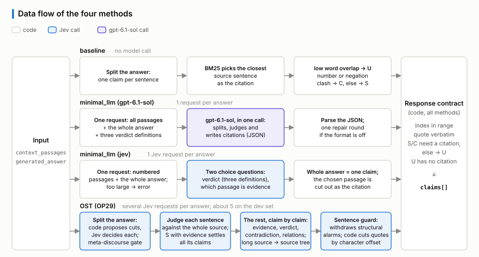

# grounding-verifier

English | [中文](README.zh-CN.md)

An HTTP service that checks an LLM-generated answer against the provided source passages: it
splits the answer into claims, judges each one `SUPPORTED` / `CONTRADICTED` / `UNSUPPORTED`, and
attaches verbatim citations.

**Contents**

- [The three methods](#the-three-methods)
  - [Data flow](#data-flow)
- [OP29, the optimized version](#op29-the-optimized-version)
- [Evaluation report](#evaluation-report)
  - [The evaluation set](#the-evaluation-set)
  - [Results](#results)
  - [Key failure cases](#key-failure-cases)
  - [Iteration](#iteration)
  - [Cost](#cost)
- [Run](#run)
- [Tests](#tests)
- [Benchmark](#benchmark)
- [Documents and appendix](#documents-and-appendix)

## The three methods

Where the three methods are:

| method | folder | model calls and implementation |
|---|---|---|
| baseline | [`src/verifier/methods/baseline/`](src/verifier/methods/baseline/) | No model calls. Each answer sentence is a claim; BM25 picks the citation; lexical coverage, number and negation checks give the verdict. |
| minimal_llm | [`src/verifier/methods/minimal_llm/`](src/verifier/methods/minimal_llm/) (gpt-6.1-sol)<br>[`src/verifier/methods/minimal_jev/`](src/verifier/methods/minimal_jev/) (jev) | One model call per answer with all passages and the whole answer. gpt-6.1-sol splits, judges and cites in that call; Jev answers choice questions, so the whole answer is one claim. |
| optimized (OST) | [`src/verifier/methods/optimized/`](src/verifier/methods/optimized/) | OP versions, described below. Jev only. |

Models called:

- Jev (`jev-1.13.0`, pinned): TypeSafe's judge model, called through `typesafe_sdk`. It only answers choice questions and returns a probability for each option; it writes no text. List price: $0.042 per million input tokens, output free. OST and minimal_llm (jev) call only Jev.
- gpt-6.1-sol: a generative reasoning model, called through the OpenAI API, used only in minimal_llm (gpt-6.1-sol). Third-party list price: $2 input, $10 output per million tokens.
- baseline calls no model.

All three run behind the same service ([`src/verifier/service.py`](src/verifier/service.py)) and
the same response contract ([`src/verifier/output/`](src/verifier/output/)): citation indexes in
range, quotes verbatim in the source, and no S or C verdict without a citation.

### Data flow

All four routes (minimal_llm comes in a gpt-6.1-sol and a Jev version) share the input and the
response contract; they differ in between:



## OP29, the optimized version

<sub>OPn numbers the iterations of the optimized method, OP0 to OP29; OP29 (commit `73b6a54`) is the current default.</sub>

By splitting the answer or the source into a semantic tree, and letting Jev only answer choice
questions while code decides from the probabilities, the OP versions achieve:

1. Finer judging granularity: every claim points at character offsets in the answer, so an alarm lands on the exact span. On RAGTruth, character-level F1 is 31.8, against 15.0 for judging the whole answer at once.
2. Wider reach for the model: one Jev request holds about 32k tokens. The source tree is built in windows per passage, and when the source does not fit, judging keeps only the most relevant sentences, so the service accepts sources of up to 500,000 characters per passage and in total; a single call that does not fit can only return an error.
3. A choice-only model can still split and cite: code finds the cut points and Jev decides whether to cut; code cuts each citation out of the source by offset, so it is always verbatim.
4. Traceable: every verdict carries Jev's option probabilities and evidence sentences, so an error can be traced to the piece and the step it came from.
5. Cheap and fast: on the accompanying set, accuracy is not distinguishable from a single gpt-6.1-sol call, at 0.20× the cost and a median of 1.0 s vs 7.1 s per item.
6. Hard to steer through the source: item 20 of the accompanying set hides an instruction disguised as a system message inside a passage, and OST gets all three claims right.

How it works: the answer is split into a semantic tree whose claims all point at character offsets
in the answer, and code cuts every citation out of the source by offset. Judging has two steps:
each sentence first gets one Jev question against the whole source, and the claims of a sentence
judged supported are settled as S; the remaining claims are then judged one by one. Jev only
answers choice questions and never writes text, so whether to split, which verdict and which
citation are all decided by code from its probabilities. See [design](docs/design.zh-CN.md).

Both animations are real runs. The first shows one sentence being split into claims, built into
the semantic tree, judged claim by claim and aggregated back up (item 15 of the accompanying set); the second walks
the whole pipeline on a SQLite WAL example (5 Jev requests, about $0.0003).





## Evaluation report

### The evaluation set

[`benchmark/ost30.jsonl`](benchmark/ost30.jsonl): 30 items and 71 gold claims (S 34, U 26, C 11).
Each line is a `/verify` request, and the gold uses the same format as the API response; the
frozen hash is in [`benchmark/ost30.sha256`](benchmark/ost30.sha256). Items are adapted from
public datasets (ANAH, RAGTruth, FOLIO, MuSiQue, FaithEval, VitaminC, SciTab); four of them pair
Wikipedia text with answers written for this set. The set is designed around OST characteristics
found during development, so each item tests one specific mechanism.

| category | items |
|---|---:|
| fully supported answers | 8 |
| subtle distortions (off-by-one numbers, swapped conditions, inverted negations, …) | 9 |
| extrinsic hallucinations (not in the passages, including facts true in the real world) | 8 |
| multi-passage synthesis | 4 |
| edge case: no checkable facts | 1 |

Item selection, gold and scoring rules are in the
[evaluation set and metrics](docs/evaluation.zh-CN.md). The other three edge cases the assignment
names (empty context, malformed model output, upstream API errors) are covered by offline tests.

### Results

Every method receives only `context_passages` and `generated_answer`.

| metric | baseline | minimal_llm (gpt-6.1-sol) | minimal_llm (jev) | OST (OP29) |
|---|---|---|---|---|
| claim accuracy (71 claims, 95% interval) | 0.662 [0.545, 0.761] | 0.845 [0.750, 0.922] | 0.662 [0.523, 0.784] | 0.803 [0.672, 0.898] |
| C/U alarm F1 | 0.780 | 0.909 | 0.815 | 0.877 |
| answer-level F1 | 0.750 | 0.878 | 0.865 | 0.865 |
| character-level F1 | 0.715 | 0.729 | 0.693 | 0.753 |
| real errors judged S (max 37) | 5 | 2 | 4 | 5 |
| items fully correct | 10 / 30 | 19 / 30 | 13 / 30 | 17 / 30 |
| latency per item p50 / p95 | 0.0 / 0.1 s | 7.1 / 18.1 s | 0.2 / 0.3 s | 1.0 / 1.8 s |
| estimated cost | $0 | $0.45 | $0.007 | $0.09 |

- **Against minimal_llm (gpt-6.1-sol)**, OST is not distinguishable in accuracy: OST − sol is
  −4.2 points, 95% interval [−13.0, +3.8]. OST is faster on every item and costs 0.20× as much.
- **Against minimal_llm (jev)**, the two are equal at telling whether an answer contains an error.
  What OST adds is per-claim verdicts and localization: claim accuracy +14.1 points
  [+3.4, +25.3], character-level F1 0.753 vs 0.693.

Thirty items only give wide intervals, so no winner is claimed. All metrics, the breakdown by
source length and the notes are in the [full results](docs/results.zh-CN.md).

### Key failure cases

- Both model-based methods take nearby evidence as support. In item 11 the source is about a
  different Hubbell; in item 16 two passages disagree, but only the supporting one is cited.
- Two of OST's six own errors come from splitting: in items 14 and 30 two assertions stay in one
  claim and are judged once. The rest are judging errors; in item 18, for example, the
  contradiction needs several passages combined and OST reports U.
- minimal_llm (gpt-6.1-sol) splits finer than the gold, so one unsupported fragment marks the
  whole sentence U.
- minimal_llm (jev) gives one verdict per answer: one error flags every correct sentence with it.
- The baseline is lexical only: paraphrases do not match, and distortions other than numbers and
  negation are missed.

Item-by-item analysis is in the [failure analysis](docs/failure-analysis.zh-CN.md).

### Iteration

The optimized method went from OP0 to OP29 in three phases: changing how answers are split,
developing and tuning the semantic tree and its operators, and pipeline optimization driven by
ablations of modules and their combinations. Every version was regression-tested on the 900 QA
answers of the RAGTruth development set. From OP1 to OP29, answer-level F1 went 38.9 → 48.0,
character-level F1 24.2 → 36.9, and cost per answer $0.00097 → $0.00066.

The ablations of the last phase showed that one request per answer is the better detector of
*whether* an answer is wrong (answer-level F1 77.7 vs 69.6 on RAGTruth), while judging sentence
by sentence and claim by claim is what buys localization (character-level F1 15.0 vs 31.8).
Splitting the answer helps localization, and mapping onto a source tree showed no measurable
contribution, so OP29 builds the source tree only for long sources and lets supported sentences
skip claim-level judging; the full RAGTruth cost fell from $6.91 to $2.57. See the
[version history](docs/version-history.zh-CN.md) and the [ablation](docs/ablation.zh-CN.md).

### Cost

Costs are token counts times list prices, not billing: Jev input $0.042 per million tokens with
free output; gpt-6.1-sol at third-party prices of $2 / $10 per million input / output tokens. The
longer the source, the smaller OST's cost advantage over sol; above about 26k tokens of source
OST builds a source tree and its cost steps up.


Cost per method, per version and per pipeline stage is in [cost](docs/cost.zh-CN.md).

## Run

```bash
python -m venv .venv
.venv/Scripts/pip install -e ".[dev]"      # Windows; use .venv/bin/pip elsewhere
cp .env.example .env                        # fill in OPENAI_API_KEY, TYPESAFE_API_KEY
.venv/Scripts/uvicorn verifier.service:app --port 8000
```

```bash
curl -X POST localhost:8000/verify \
  -H "Content-Type: application/json" \
  -d '{"context_passages": ["..."], "generated_answer": "..."}'
```

## Tests

```bash
.venv/Scripts/python -m pytest
```

The suite is fully offline: model behavior is scripted through fakes, and the
assignment's SQLite/WAL example runs end-to-end as a fixture.

## Benchmark

Run each method once, then score and compute per-item latency and cost. Keys per method:

- baseline: none.
- minimal_llm (gpt-6.1-sol), `--method minimal_llm`: `OPENAI_API_KEY` (gpt-6.1-sol is the default model).
- minimal_llm (jev), `--method minimal_jev`: `TYPESAFE_API_KEY`.
- OST (optimized): `TYPESAFE_API_KEY`.

```bash
.venv/Scripts/python benchmark/run_ost30.py --method baseline
.venv/Scripts/python benchmark/run_ost30.py --method minimal_llm
.venv/Scripts/python benchmark/run_ost30.py --method minimal_jev
.venv/Scripts/python benchmark/run_ost30.py --method optimized
.venv/Scripts/python benchmark/score_ost30.py baseline minimal_llm minimal_jev optimized
.venv/Scripts/python benchmark/cost_latency_ost30.py minimal_llm minimal_jev optimized
```

Results go to `var/ost30/`: each method's output is `results_<method>.jsonl`, and every model
call is recorded in `runs_<method>.sqlite3`.

- A rerun after an interruption skips the items already done.
- Calls already recorded are served from the database, so they are not paid for again.
- To run the same method with another model, add `--tag` (e.g. `--tag _qwen`); its results are
  stored separately.

The scoring rules are at the top of [`benchmark/score_ost30.py`](benchmark/score_ost30.py):

- how system claims are matched to gold sentences;
- how a sentence split into several claims gets one verdict;
- when a citation counts as supporting.

Hand rulings are in the two JSON files under `benchmark/`.

Reproducing:

- [`benchmark/ost30_build/`](benchmark/ost30_build/) rebuilds OST30 from the public source datasets, byte for byte.
- [`benchmark/ragtruth/`](benchmark/ragtruth/) builds the RAGTruth development inputs, runs a method and scores it; the
  recorded predictions of every run in the docs are included, so the numbers rescore without a model call.
- The raw responses and call logs of the four runs in the results table are in
  [`docs/appendix/data/ost30_runs/`](docs/appendix/data/ost30_runs/).

## Documents and appendix

Details are in [`docs/`](docs/) (in Chinese for now):

| type | name | what it covers |
|---|---|---|
| document | [Design](docs/design.zh-CN.md) | design rationale, the semantic tree and its operators, how Jev is used, one verification run step by step, deterministic validation, error boundaries |
| document | [Evaluation set and metrics](docs/evaluation.zh-CN.md) | how the 30 items were chosen, how the gold was set, scoring rules, metric definitions |
| document | [Full results](docs/results.zh-CN.md) | every metric on the accompanying set with notes, and the comparison on the RAGTruth development set |
| document | [Failure analysis](docs/failure-analysis.zh-CN.md) | which items of the accompanying set OST30 each method gets wrong and why, and how the design hypotheses held up |
| document | [Version history](docs/version-history.zh-CN.md) | OP0 → OP29 in three phases: what changed and what moved |
| document | [Ablation](docs/ablation.zh-CN.md) | what each OST mechanism contributes |
| document | [Cost](docs/cost.zh-CN.md) | cost per method and per version, and where the money goes |
| appendix | [Per-version data](docs/appendix/version-table.zh-CN.md) | every version OP0 → OP29: change, motivation, scores, cost and latency |
| appendix | [The semantic tree, formally](docs/appendix/semantic-tree-proofs.zh-CN.md) | the splitting operators and verdict composition rules formalized: what can be proved, under which premises, and counterexamples run |
| appendix | [Audit of overlapping logic functions](docs/appendix/redundancy-audit.zh-CN.md) | whether functions and word lists that carry logic overlap: which overlaps are provably redundant and which provably needed |
| appendix | [Jev question catalogue](docs/appendix/jev-questions.zh-CN.md) | which questions Jev is asked at each stage, their options, and how code uses the answers |
| appendix | [OST30 extraction rules](docs/appendix/ost30-extraction.zh-CN.md) | per-type selection rules, seeds, skip reasons, gold changes, and how synthetic answers were written |
| appendix | [Raw responses and data tables](docs/appendix/README.md#数据) | raw responses and call logs of the four runs in the results table; data tables per claim, per version, per ablation step and per cost stage |
