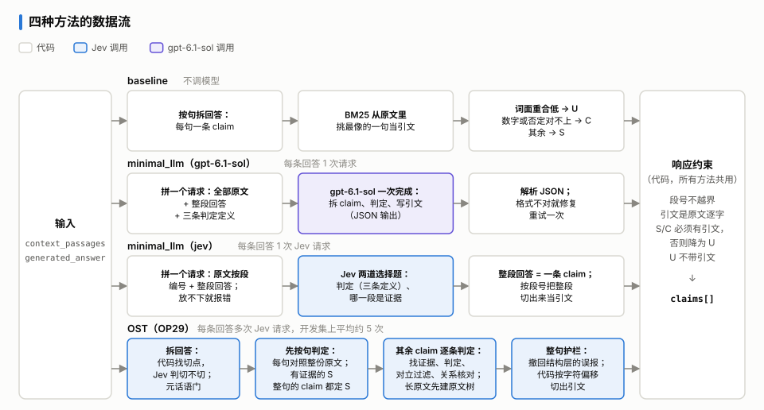
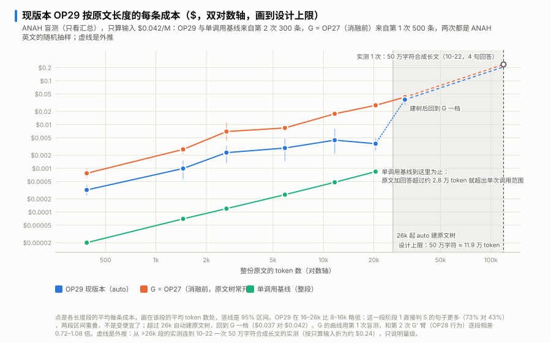

# grounding-verifier

[English](README.md) | 中文

一个 HTTP 服务：把大模型生成的回答对照给定的原文段落做核查，拆成 claim，逐条判定 `SUPPORTED` / `CONTRADICTED` / `UNSUPPORTED`，并附上逐字引文。

**目录**

- [三种方法](#三种方法)
- [OP29：优化版本](#op29优化版本)
- [评测报告](#评测报告)
  - [评测集](#评测集)
  - [结果](#结果)
  - [关键失败案例](#关键失败案例)
  - [迭代过程](#迭代过程)
  - [成本](#成本)
  - [指标定义](#指标定义)
- [运行](#运行)
- [测试](#测试)
- [跑分](#跑分)
- [文档以及附件列表](#文档以及附件列表)

## 三种方法

三种方法在这些文件夹里：

| 方法 | 文件夹 | 模型调用与实现方法 |
|---|---|---|
| baseline | [`src/verifier/methods/baseline/`](src/verifier/methods/baseline/) | 不调模型。回答的每一句是一条 claim，BM25 选引文，词面覆盖、数字和否定检查给判定。 |
| minimal_llm | [`src/verifier/methods/minimal_llm/`](src/verifier/methods/minimal_llm/)（gpt-6.1-sol）<br>[`src/verifier/methods/minimal_jev/`](src/verifier/methods/minimal_jev/)（jev） | 每条回答调一次模型，放进全部原文和整段回答。gpt-6.1-sol 在这一次调用里自己拆分、判定、给引文；Jev 只回答选择题，整段回答就是一条 claim。 |
| optimized（OST） | [`src/verifier/methods/optimized/`](src/verifier/methods/optimized/) | OP 版本，见下文。只调 Jev。 |

四条路线（minimal_llm 有 gpt-6.1-sol 和 jev 两个版本）的输入和响应约束相同，区别在中间：



调用的模型：

- Jev（`jev-1.13.0`，版本固定）：TypeSafe 的判定模型，用 `typesafe_sdk` 调用。它只回答选择题，返回每个选项的概率，不生成文字。按标价输入每百万 token $0.042，输出不收费。OST 和 minimal_llm（jev）只调它。
- gpt-6.1-sol：生成式推理模型，用 OpenAI API 调用，只在 minimal_llm（gpt-6.1-sol）里用。按第三方标价，输入每百万 token $2，输出 $10。
- baseline 不调模型。

三种方法共用同一个服务（[`src/verifier/service.py`](src/verifier/service.py)）和同一套响应约束（[`src/verifier/output/`](src/verifier/output/)）：引文段号不越界、引文是原文的逐字子串、判 S / C 必须有引文。

## OP29：优化版本

<sub>OPn 是优化方法的迭代编号，从 OP0 到 OP29；OP29（提交 `73b6a54`）是现行默认。</sub>

通过把回答或原文拆分成语义树，再让 Jev 只做选择题、由代码按概率决定，OP版本做到了：

1. 更细的判断颗粒度：每个 claim 都指向回答里的字符偏移，报警能落到具体那一段。RAGTruth 上字符级 F1 31.8，整段一次判只有 15.0。
2. 扩展了模型的可用性：Jev 一次请求大约放 3.2 万 token。原文树按段落分窗口建，判定时放不下就只留最相关的句子，所以入口能收单段和总长各 50 万字符的原文；单次调用放不下就只能报错。
3. 只会做选择题的模型也能拆分、给引文：切点由代码找，切不切由 Jev 判断；引文由代码按偏移从原文切出，一定是逐字原文。
4. 可追踪：每个判定都带着 Jev 的选项概率和证据句，出错能追到是哪一块、哪一步。
5. 便宜、快：附带测评集上和 gpt-6.1-sol 单次调用的正确率分不出高下，成本是它的 0.20 倍，每题耗时中位数 1.0 秒对 7.1 秒。
6. 鲁棒性：附带测评集第 20 题原文里夹了一段伪装成系统消息的指令，OST 三条全对。

怎么做的：把回答拆成一棵语义树，树上的每个 claim 都指向回答里的字符偏移，引文由代码按偏移从原文切出。判定分两步：每一句先用一个 Jev 问题对照整份原文判一次，判为支持的句子，里面的 claim 直接定为 S；其余的 claim 再逐条判定。Jev 只做选择题、不写字，拆不拆、判什么、引哪句都由代码按概率决定。详见[设计与实现](docs/design.zh-CN.md)。

下面两张动图都是真实运行。第一张看一句话怎么拆成 claim、建成语义树、再逐条判定往上汇总（附带测评集第 15 题）；第二张用一个 SQLite WAL 例子走一遍整条流程（5 次 Jev 请求，约 $0.0003）。





## 评测报告

### 评测集

[`benchmark/ost30.jsonl`](benchmark/ost30.jsonl)，30 题，71 条金标 claim（S 34、U 26、C 11）。每行就是一个 `/verify` 请求，金标和接口响应的格式相同；冻结哈希在 [`benchmark/ost30.sha256`](benchmark/ost30.sha256)。题目改编自公开数据集 ANAH、RAGTruth、FOLIO、MuSiQue、FaithEval、VitaminC、SciTab，其中 4 题是在维基百科原文上自己写的回答。这套题是按开发中发现的 OST 的特性设计的，每题考一个具体的机制。

| 类别 | 题数 |
|---|---:|
| 完全支持的回答 | 8 |
| 细微扭曲（数字差一、条件互换、否定反转等） | 9 |
| 外部幻觉（原文没有，包括现实中为真的） | 8 |
| 多段综合 | 4 |
| 边界情况：没有可核对的事实 | 1 |

选题、金标和打分规则见[评测集与指标](docs/evaluation.zh-CN.md)。作业要求的另外三种边界情况（空原文、模型输出格式坏、上游 API 出错）由离线测试覆盖。

### 结果

所有方法的输入都只有 `context_passages` 和 `generated_answer`。

| 指标                     | baseline             | minimal_llm（gpt-6.1-sol） | minimal_llm（jev）     | OST（OP29）            |
| ---------------------- | -------------------- | ------------------------ | -------------------- | -------------------- |
| claim 准确率（71 条，95% 区间） | 0.662 [0.545, 0.761] | 0.845 [0.750, 0.922]     | 0.662 [0.523, 0.784] | 0.803 [0.672, 0.898] |
| C/U 报警 F1              | 0.780                | 0.909                    | 0.815                | 0.877                |
| 回答级 F1                 | 0.750                | 0.878                    | 0.865                | 0.865                |
| 字符级 F1                 | 0.715                | 0.729                    | 0.693                | 0.753                |
| 真错判成 S（max 37）         | 5                    | 2                        | 4                    | 5                    |
| 整题全对                   | 10 / 30              | 19 / 30                  | 13 / 30              | 17 / 30              |
| 每题耗时 p50 / p95         | 0.0 / 0.1 s          | 7.1 / 18.1 s             | 0.2 / 0.3 s          | 1.0 / 1.8 s          |
| 推算成本                   | $0                   | $0.45                    | $0.007               | $0.09                |

- **和 minimal_llm（gpt-6.1-sol）比**：正确率分不出高下，OST − sol 是 −4.2 个百分点，95% 区间 [−13.0, +3.8]。OST 每题都更快，成本是它的 0.20 倍。
- **和 minimal_llm（jev）比**：判断一段回答有没有错，两者一样。OST 多出来的是逐条判定和定位：claim 准确率高 14.1 个百分点 [+3.4, +25.3]，字符级 F1 0.753 对 0.693。

30 题给出的区间很宽，所以不说谁胜谁负。全部指标、按原文长度分档和其他说明见[完整结果](docs/results.zh-CN.md)。

### 关键失败案例

- 两种模型方法都会把相近的证据当成支持：11 题原文说的是另一位 Hubbell；16 题两段原文说法冲突，却只引了支持的那段。
- OST 单独错的 6 条里，两条出在拆分：14、30 题两个断言没切开，只判了一次。其余出在判定，例如 18 题要组合几段原文才能反驳，OST 只报了 U。
- minimal_llm（gpt-6.1-sol）拆得比金标细，一句里只要有一小条找不到依据，整句就记成 U。
- minimal_llm（jev）整段只给一个判定：一段回答里有一处错，其余正确的句子也跟着报警。
- baseline 只看词面：同义改写对不上，数字和否定以外的扭曲也抓不到。

逐题分析见[失败分析](docs/failure-analysis.zh-CN.md)。

### 迭代过程

优化版从 OP0 迭代到 OP29，分三个阶段：换拆分方式，语义树与算子开发及调整，模块及组合的消融实验驱动的推理管线优化。每个版本都在开发集 RAGTruth 的 900 条 QA 回答上回归。从 OP1 到 OP29，回答级 F1 38.9 → 48.0，字符级 F1 24.2 → 36.9，每条回答成本 $0.00097 → $0.00066。

最后一个阶段的消融实验显示：判断「有没有错」，整段一次请求反而更准（RAGTruth 上回答级 F1 77.7 对 69.6）；按句、按 claim 拆开判，换来的是定位（字符级 F1 15.0 对 31.8）。答案拆分的价值在定位，原文树映射测不出贡献，所以 OP29 把原文树改成只在长原文上建，并让判为支持的句子跳过逐条判定，RAGTruth 全量成本从 $6.91 降到 $2.57。详见[版本迭代](docs/version-history.zh-CN.md)和[消融实验](docs/ablation.zh-CN.md)。

开发集上的结论还在外部数据上验证过（LLM-AggreFact、两次 ANAH、TRIVIA+ test、FaithBench，盲测集只看汇总数）：和 minimal_llm（jev）相比，OST 定位上的优势在 ANAH 两次上都复现了（句子级 F1 +7.6、+6.9），TRIVIA+ 和 FaithBench 上看不出差别；回答级检出大多打平；开发集上不到 1 分的提升（OP29 对 OP28）没有复现。详见[外部实验](docs/version-history.zh-CN.md#外部实验)和[迭代的结论](docs/version-history.zh-CN.md#迭代的结论)。

迭代的结论：

- 拆分有用，但有个度：拆开判换来的是定位，拆得越细噪声越多。这个度是在开发集上用消融定下来的，就是 OP29。
- OST 极大增强了 Jev 在定位上的表现：RAGTruth 字符级 F1 15.0 → 31.8，ANAH 两次句子级 +7.6、+6.9。
- 回答级检出不是 OST 的卖点：整段一次判在开发集上高 8.0，外部数据上大多打平。
- 开发集上的小幅提升不一定能推广：OP29 对 OP28 在开发集上高 0.71，在 ANAH 上没有复现。
- 检出上的增益来自撤回误报的机制，而且不依赖语义树：元话语门 +1.46，找证据的方式 +0.55，护栏扩展加关父节点复核 +0.88；原文树映射测不出贡献。
- OST 擅长撤回误报，不擅长新增报警：从整段一次判换成按句判，回答级掉 11.4，OST 收回约 3.4。
- 准确率差不多，花得更少、跑得更快：开发集全量成本 $6.91 → $2.57，单条延迟 1.27 s → 0.71 s；和 gpt-6.1-sol 单次调用比，成本 0.20 倍，耗时中位数 1.0 秒对 7.1 秒。

每一条的依据见[迭代的结论](docs/version-history.zh-CN.md#迭代的结论)。

### 成本

按标价推算，只算 token，不是账单：Jev 输入每百万 token $0.042、输出不收费；gpt-6.1-sol 按第三方标价，输入 $2、输出 $10。原文越长，OST 相对 sol 的成本优势越小；原文超过约 2.6 万 token 时 OST 会建原文树，成本上一个台阶。



各方法、各版本的成本和分环节的账见[成本](docs/cost.zh-CN.md)。

### 指标定义

| 指标 | 定义 |
|---|---|
| claim 准确率 | 71 条金标 claim 里判对的比例。各方法自己拆 claim，拆出来的先对到金标句上；一句对上几条时取最重的判定（C > U > S），一条都没对上的算错。对齐规则见[评测集与指标](docs/evaluation.zh-CN.md#打分规则) |
| C/U 报警 F1 | 把 C 和 U 都当「报警」、S 当「不报警」，在 71 条金标 claim 上算 F1：报警抓得准不准、全不全 |
| 回答级 F1 | 一题当一个单位，「有错」为正类：金标里有任何一条 C / U 就算有错；系统有任何一条 claim 判 C / U 就算报警 |
| 字符级 F1 | 系统判 C / U 的 claim 在回答里占的字符，对金标标出的错误片段算 F1，所有题的字符合在一起算。看「错在哪」标得准不准 |
| 真错判成 S | 37 条有错（C 或 U）的金标 claim 里，被判成 S 的条数。这是最危险的错 |
| 整题全对 | 每条金标 claim 都判对，而且多出来的 claim 和非事实句上没有误报的题数 |
| 每题耗时 p50 / p95 | 每题从占到并发位（同时最多 4 题）到拿到响应的时间。p50 是中位数；p95 在 30 题里就是倒数第三慢的那题 |
| 推算成本 | 调用记录里的 token 数乘标价，不是账单。Jev 只算输入 |
| 句子级 F1、平衡准确率 | 外部数据上用。句子级 F1：金标有错的句子为正类，系统在这句上判了 C / U 算报警。平衡准确率：「有错」「没错」两类回答各自的召回率取平均，不受两类比例影响 |

区间都是 95%。每个方法自己的区间按题重采样 2,000 次，方法之间的差用配对重采样 10,000 次，种子 20261022；29、30 两题共用原文，算作一组。RAGTruth 上的回答级和字符级 F1 定义相同，金标用 RAGTruth 自己标的幻觉片段。

## 运行

```bash
python -m venv .venv
.venv/Scripts/pip install -e ".[dev]"      # Windows；其他系统用 .venv/bin/pip
cp .env.example .env                        # 填入 OPENAI_API_KEY、TYPESAFE_API_KEY
.venv/Scripts/uvicorn verifier.service:app --port 8000
```

服务默认跑 OST（OP29）。换方法在 `.env` 里设 `GV_METHOD`：

| `GV_METHOD` | 方法 | 需要的 key |
|---|---|---|
| `optimized`（默认） | OST（OP29） | `TYPESAFE_API_KEY` |
| `baseline` | baseline | 不需要 |
| `minimal_llm` | minimal_llm（gpt-6.1-sol） | `OPENAI_API_KEY` |
| `minimal_jev` | minimal_llm（jev） | `TYPESAFE_API_KEY` |

[`config.py`](src/verifier/harness/config.py) 里其余几个取值（`minimal_jev_seg` 等）是消融实验用的。

用 SQLite WAL 例子发一个请求，请求体在 [`examples/wal_request.json`](examples/wal_request.json)：

```bash
curl -X POST localhost:8000/verify \
  -H "Content-Type: application/json" \
  -d @examples/wal_request.json
```

返回（OP29 的一次真实运行，原样照录）：

```json
{
  "claims": [
    {
      "claim_text": "SQLite WAL mode allows multiple processes across different host machines on an NFS network share to write concurrently.",
      "verdict": "CONTRADICTED",
      "reasoning": "The cited source text explicitly states the opposite of the claim (P0.S2) (calibrated p=1.00).",
      "citations": [
        {
          "index": 0,
          "quote": "However, WAL does not work over a network filesystem because it requires all processes to share a small amount of memory via shared memory files (-shm).",
          "start_char": 231,
          "end_char": 383
        }
      ]
    },
    {
      "claim_text": "Alongside the main database file, it uses two auxiliary files (-wal and -shm) and automatically checkpoints when the log reaches roughly 1,000 pages.",
      "verdict": "SUPPORTED",
      "reasoning": "The cited source text entails the claim (P1.S0) (calibrated p=1.00).",
      "citations": [
        {
          "index": 1,
          "quote": "When in active use, the state of a WAL mode database is described by three separate files: the main database file 'X', the write-ahead log file 'X-wal', and the wal-index shared-memory file 'X-shm'.",
          "start_char": 0,
          "end_char": 198
        }
      ]
    },
    {
      "claim_text": "By default, WAL files are encrypted with AES-256 at rest.",
      "verdict": "UNSUPPORTED",
      "reasoning": "The source passages neither establish nor contradict this claim (calibrated p=1.00); it may be true elsewhere, but it cannot be verified from the provided context.",
      "citations": []
    }
  ]
}
```

第二句没有拆开：句子里有条件（when the log reaches …），按拆分规则整句保留。引文只引了讲三个文件的那一句，没有引自动检查点那一句。

## 测试

```bash
.venv/Scripts/python -m pytest
```

整套测试完全离线：模型行为用假对象按脚本给出，作业里的 SQLite/WAL 例子作为固定用例端到端跑一遍。

## 跑分

每种方法各跑一遍，再打分、统计每题的耗时和成本。每种方法需要的 key：
- baseline：不需要；
- minimal_llm（gpt-6.1-sol），`--method minimal_llm`：`OPENAI_API_KEY`，默认模型就是 gpt-6.1-sol；
- minimal_llm（jev），`--method minimal_jev`：`TYPESAFE_API_KEY`；
- OST（optimized）：`TYPESAFE_API_KEY`。

```bash
.venv/Scripts/python benchmark/run_ost30.py --method baseline
.venv/Scripts/python benchmark/run_ost30.py --method minimal_llm
.venv/Scripts/python benchmark/run_ost30.py --method minimal_jev
.venv/Scripts/python benchmark/run_ost30.py --method optimized
.venv/Scripts/python benchmark/score_ost30.py baseline minimal_llm minimal_jev optimized
.venv/Scripts/python benchmark/cost_latency_ost30.py minimal_llm minimal_jev optimized
```

结果写在 `var/ost30/`：每种方法的输出是 `results_<方法>.jsonl`，每次模型调用都记在 `runs_<方法>.sqlite3` 里。
- 中断后再跑，已经跑完的题会跳过。
- 已经记录过的调用直接从库里取，不会再花钱。
- 要用另一个模型再跑同一种方法，加 `--tag`（如 `--tag _qwen`），结果会单独存一份。

评分规则写在 [`benchmark/score_ost30.py`](benchmark/score_ost30.py) 开头：
- 系统拆出的 claim 怎么对到金标句上；
- 一句被拆成几条时怎么合成这一句的判定；
- 引文怎么算撑得住。

人工裁定记在 `benchmark/` 下的两份 json 里。

复现：
- OST30 能用 [`benchmark/ost30_build/`](benchmark/ost30_build/) 从公开数据集重建，和冻结的文件逐字节相同。
- 开发集 RAGTruth 的输入构建、运行和打分在 [`benchmark/ragtruth/`](benchmark/ragtruth/)，附每次运行的预测，可以不调模型复算文档里的数字。
- README 结果表那四次运行的原始响应和调用记录在 [`docs/appendix/data/ost30_runs/`](docs/appendix/data/ost30_runs/)。

## 文档以及附件列表

具体详情请看文档 [`docs/`](docs/)：

| 类别  | 名称                                                      | 简介                                       |
| --- | ------------------------------------------------------- | ---------------------------------------- |
| 文档  | [设计与实现](docs/design.zh-CN.md)                           | 设计思路、语义树和算子、Jev 怎么用、一次判定的流程、确定性校验、错误边界   |
| 文档  | [评测集与指标](docs/evaluation.zh-CN.md)                      | 30 道题怎么选、金标怎么定、打分规则、每个指标的定义              |
| 文档  | [完整结果](docs/results.zh-CN.md)                           | 附带测评集的全部指标和说明，开发集 RAGTruth 上的对照          |
| 文档  | [失败分析](docs/failure-analysis.zh-CN.md)                  | 各方法在附带测评集OST30的测试中错在哪些题、为什么错，以及设计假设的检验结果 |
| 文档  | [版本迭代](docs/version-history.zh-CN.md)                   | OP0 → OP29 的三个阶段，每个阶段改了什么、数字动了多少         |
| 文档  | [消融实验](docs/ablation.zh-CN.md)                          | OST 的每个机制各自贡献多少                          |
| 文档  | [成本](docs/cost.zh-CN.md)                                | 各方法、各版本的成本，以及钱花在哪一环                      |
| 附件  | [逐版本数据](docs/appendix/version-table.zh-CN.md)           | OP0 → OP29 每个版本的改动、起因、分数、成本和延迟           |
| 附件  | [语义树的数学论证](docs/appendix/semantic-tree-proofs.zh-CN.md) | 拆分算子和判定组合规则的形式化：能证明什么、前提是什么、反例实测         |
| 附件  | [逻辑函数的职责重合审查](docs/appendix/redundancy-audit.zh-CN.md)  | 承载逻辑语义的函数和词表有没有重复：哪几处可证冗余、哪几处可证必要        |
| 附件  | [Jev 题目清单](docs/appendix/jev-questions.zh-CN.md)        | 每个阶段问 Jev 哪些题、选项是什么、代码怎么用答案              |
| 附件  | [OST30 抽取标准](docs/appendix/ost30-extraction.zh-CN.md)   | 每个题型的筛选规则、种子、跳过理由、金标改动、合成回答怎么写           |
| 附件  | [原始响应和数据表](docs/appendix/README.md#数据)                         | 结果表四次运行的原始响应和调用记录，逐条判定、逐版本、消融、成本的数据表     |
