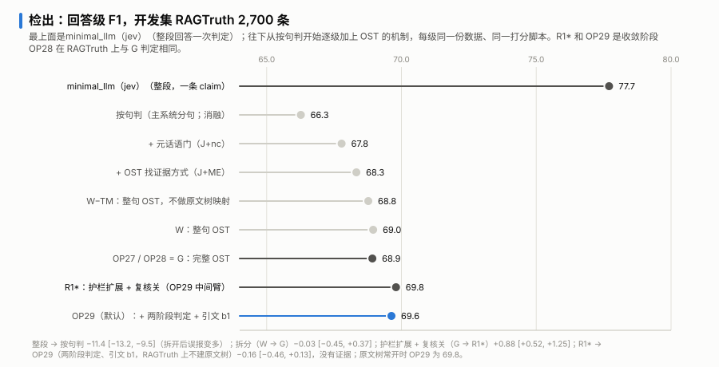
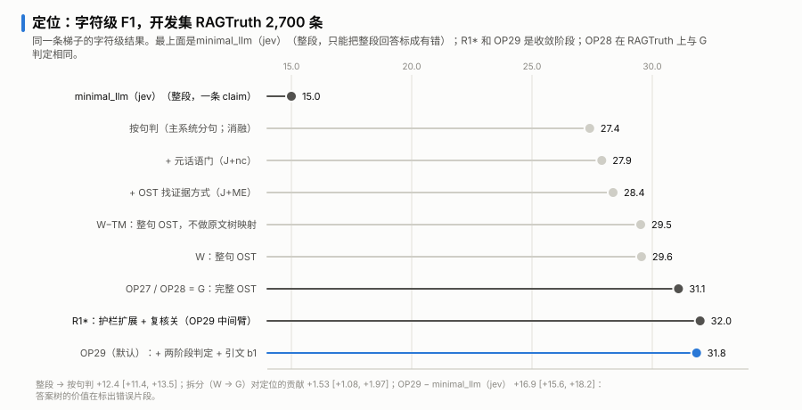

# 消融实验：OST 的每个机制值多少

[返回 README](../README.zh-CN.md)

这份文档回答一个问题：和每条回答只发一次请求的 minimal_llm（jev）相比，OST 多出来的每个机制，各自贡献了什么。

做法：
- 数据是 RAGTruth 全量 2,700 条回答。这是我们的开发集，系统在它上面调过，所以绝对分数偏乐观；这里看的是机制之间的差。
- 从 minimal_llm（jev）出发，一次加一个机制，每一级同一份数据、同一个打分脚本。
- 指标：回答级 F1（这段回答有没有错）和字符级 F1（错的片段标得准不准）。
- 差值用按任务分层的配对 bootstrap，10,000 次，种子 20261022，给 95% 区间。区间不含 0 才算有证据。
- 每一级的增量是在各自的上一级上量的，不能逐级相加去分摊总差值，只用来说明这一级有没有贡献。

## 梯子

| 一级 | 回答级 / 字符级 F1 | 这一级的增量（回答级 / 字符级） |
|---|---|---|
| minimal_llm（jev）：整段回答一次判定 | 77.70 / 15.00 | |
| 按句判：每句单独问一次 | 66.32 / 27.39 | −11.38 [−13.23, −9.54] / +12.44 [+11.36, +13.54] |
| + 元话语门 | 67.78 / 27.90 | +1.46 [+1.09, +1.86] / +0.51 [+0.32, +0.68] |
| + OST 找证据的方式 | 68.30 / 28.40 | +0.55 [+0.27, +0.85] / +0.47 [+0.36, +0.58] |
| W−TM：对着整份原文判定，不建原文树 | 68.80 / 29.50 | 和上一级相比约 +0.5 / +1.1（未单独算区间） |
| W：再加原文树映射 | 68.95 / 29.55 | +0.18 [−0.17, +0.54] / +0.03，没有证据 |
| OP27：再加答案拆分（完整 OST） | 68.92 / 31.09 | −0.03 [−0.45, +0.37] / +1.53 [+1.08, +1.97] |
| R1*：护栏扩到整句 U/C，关父节点复核 | 69.80 / 31.99 | +0.88 [+0.52, +1.25] / +0.90 [+0.65, +1.15] |
| OP29（默认）：先按句判定、引文选择题、原文树只在长原文上建 | 69.63 / 31.84 | −0.16 [−0.46, +0.13] / −0.15 [−0.31, +0.01]，没有证据 |

## 读法

- **整段 → 按句判是最大的一步，而且两个方向相反。** 字符级 +12.4，回答级 −11.4。每句单独问，错误能定位到句子，但每多问一句，就多一次误报的机会。
- **检出上的增益能搬到单次调用。** 元话语门（+1.46）和 OST 找证据的方式（+0.55）都不依赖语义树，可以直接加到按句判上。
- **原文树映射对检出和定位都测不出贡献**（+0.18 / +0.03）。所以 OP29 把原文树改成只在原文超过约 2.6 万 token 时才建，那时整份原文放不进一次判定。
- **答案拆分的价值在定位，不在检出。** 从 W 到 OP27 回答级 −0.03，字符级 +1.53。判定相同的回答里，片段定位 +2.24。
- **还能提升的方向是多撤回误报。** 护栏扩展加关父节点复核 +0.88 / +0.90，这是 OP29 采用的改动之一。
- **先按句判定不损失准确率，省一半以上的钱。** 判 S 的句子直接继承，不再做片段判定。拆开看：
  - 加先按句判定：−0.03 [−0.30, +0.24] / −0.05 [−0.20, +0.10]，成本 $6.33 → $3.15；
  - 加引文选择题：分数不变，成本 +$0.19；
  - 原文树按长度自动（RAGTruth 上不建）：−0.14 [−0.30, +0.03] / −0.10 [−0.20, −0.00]，成本 → $2.57。

## 「整段 → 按句判」这一步拆开看

整段和按句判之间同时变了三样东西：判定定义的措辞、判定的粒度、证据的粒度。为了分开它们，加了一个中间臂：整段一次判定，但用按句判那套转述过的判定定义。另外把整段判定原样重跑一次，量抽样噪声。

| 比较 | 回答级 F1 | 字符级 F1 |
|---|---|---|
| 整段 → 按句判（原来的一步） | −11.38 [−13.23, −9.54] | +12.44 [+11.36, +13.54] |
| 只换定义措辞 | −2.16 [−3.25, −1.12] | −0.42 [−1.10, +0.13]，没有证据 |
| 换判定和证据的粒度 | −9.22 [−11.26, −7.15] | +12.86 [+11.63, +14.21] |
| 同一配置跑两次（抽样噪声） | −0.05 [−0.57, +0.46] | −0.05 [−0.25, +0.12] |

- 转述的定义（「the passages state it」）比题目原文的定义（「Fully entailed …」）松，整段更容易判 S：召回从 83.5 降到 77.7。
- 措辞只占回答级下降的约五分之一。字符级的提升几乎全来自粒度。

## 证据排名回退的贡献

找证据时，如果没有一句原文过相关性门槛（0.60），系统保留排名第一、而且分数不低于 0.30 的那句作证据，判定照常给出。这条规则叫证据排名回退。我们在缓存上精确回放了「去掉回退」的版本，没有新的模型调用。

| 系统 | 有回退 − 无回退（回答级 / 字符级） |
|---|---|
| + OST 找证据的方式 | +0.91 [+0.52, +1.29] / +0.76 [+0.59, +0.93] |
| W | +0.80 [+0.47, +1.14] / +0.73 [+0.56, +0.91] |
| OP27 | +0.85 [+0.53, +1.18] / +0.74 [+0.56, +0.92] |
| R1* | +0.36 [+0.14, +0.59] / +0.35 [+0.24, +0.47] |
| OP29（原文树常开） | +0.44 [+0.17, +0.73] / +0.39 [+0.27, +0.51] |

去掉回退以后，几组比较变成这样：

| 比较 | 有回退 | 无回退 |
|---|---|---|
| + OST 找证据的方式 − 按句判 + 元话语门 | +0.55 / +0.47 | −0.36 [−0.81, +0.10] / −0.30 [−0.49, −0.11] |
| W − 按句判 + 元话语门 | +0.99 / +1.63 | +0.19 [−0.50, +0.89] / +0.89 [+0.53, +1.27] |
| OP27 − 按句判 + 元话语门 | +0.96 / +3.16 | +0.11 [−0.49, +0.72] / +2.42 [+1.91, +2.94] |
| OP29（原文树常开）− OP27 | +0.85 / +0.86 | +1.25 [+0.78, +1.72] / +1.21 [+0.89, +1.52] |

- OST 在检出上相对「按句判 + 元话语门」的那约 1 分优势，几乎全部来自这条回退。
- 定位上的优势大部分不依赖它：OP27 约四分之三、W 约一半。
- 和 minimal_llm（jev）的比较不受影响。
- 我们原来的设计是「没有相关证据就判 U」。消融显示回退更好，所以保留回退。

## 另外核对过的

- **两条出处门跳过规则**（前件封顶、不可检查的单元跳过出处门）：补全后，有护栏的各版本都只改了同一个单元，而且改错了（金标有幻觉，补全后反而放过）。所有比较的结论不变，代码目前保持原样。
