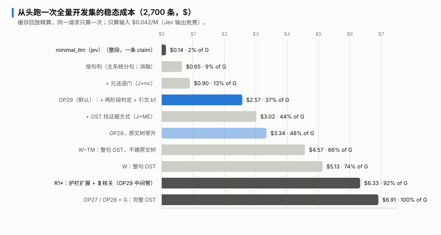
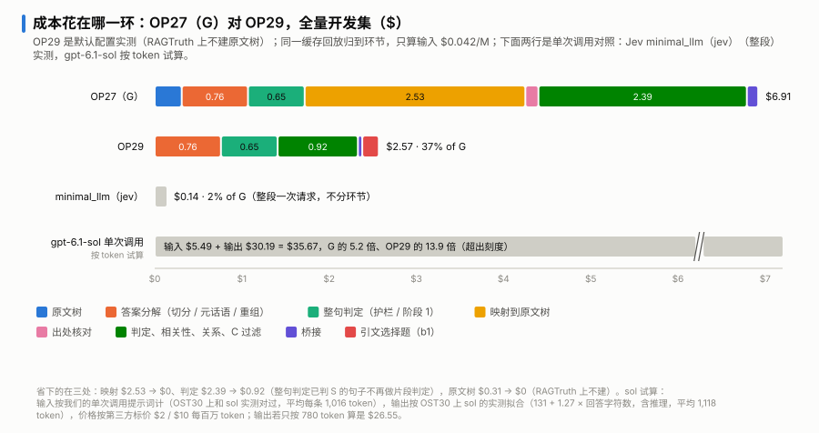

# 成本

[返回 README](../README.zh-CN.md)

## 怎么算的

- 所有金额都是**调用台账上的 token 数乘标价**，不是账单。
- Jev 按官方标价只收输入：每百万 token $0.042，输出不收费。gpt-6.1-sol 按第三方标价：输入 $2、输出 $10（每百万 token）。
- 「稳态成本」是从头完整跑一次的成本：用缓存回放把每个请求归到它的回答上，同一个请求只算一次。开发集里同一份原文有几条回答，它们共用缓存，所以正式服务里每条回答的成本会比这里略高，尤其是要建原文树的长原文。

## 附带测评集 OST30（30 题）

分数和其他指标见[完整结果](results.zh-CN.md)。

| | baseline | minimal_llm（gpt-6.1-sol） | minimal_llm（jev） | OST（OP29） |
|---|---:|---:|---:|---:|
| 30 题成本 | $0 | $0.449 | $0.007 | $0.091 |
| 每题耗时 p50 / p95 | 0.0 / 0.1 s | 7.1 / 18.1 s | 0.2 / 0.3 s | 1.0 / 1.8 s |

按原文长度分档：

| 原文长度 | 题数 | sol 每题成本 | OST 每题成本 | OST ÷ sol | sol 平均耗时 | OST 平均耗时 |
|---|---:|---:|---:|---:|---:|---:|
| 短（< 5 千字符） | 10 | $0.0056 | $0.0004 | 0.07 | 9.2 s | 1.2 s |
| 中（5 千–2 万） | 12 | $0.0100 | $0.0010 | 0.10 | 8.5 s | 1.0 s |
| 长（2 万–12.4 万） | 8 | $0.0340 | $0.0094 | 0.27 | 9.2 s | 1.5 s |
| 合计 | 30 | $0.449 | $0.091 | 0.20 | | |

- minimal_llm（jev）在各档都是每题 0.2 秒、不到 $0.001。
- 原文越长，OST 相对 sol 的优势越小：OST 的每个问题都带着原文，原文越长每个问题越贵；sol 只调一次，原文只算一遍输入。
- 原文超过约 2.6 万 token 时，OST 会建原文树，每题成本明显上一个台阶。OST30 里只有一题（第 28 题，12.4 万字符）建树。

## 开发集 RAGTruth（2,700 条）的稳态成本

| 配置 | 全量 | 每条 | 占 OP27 |
|---|---:|---:|---:|
| minimal_llm（jev）：整段一次请求 | $0.14 | $0.00005 | 2% |
| 按句判（消融的一级） | $0.65 | $0.00024 | 9% |
| + 元话语门 | $0.90 | $0.00033 | 13% |
| + OST 找证据的方式 | $3.02 | $0.0011 | 44% |
| W−TM：整句 OST，不建原文树 | $4.57 | $0.0017 | 66% |
| W：整句 OST | $5.13 | $0.0019 | 74% |
| OP27：完整 OST | $6.91 | $0.0026 | 100% |
| R1*：护栏扩展 + 关复核 | $6.33 | $0.0023 | 92% |
| R1* + 先按句判定 | $3.15 | $0.0012 | 46% |
| OP29，原文树常开 | $3.34 | $0.0012 | 48% |
| **OP29，默认（RAGTruth 上不建原文树）** | **$2.57** | **$0.00095** | **37%** |

gpt-6.1-sol 单次调用没有在全量上跑，按 token 试算约 $35.7（输入 $5.5、输出 $30.2），是 OP29 默认的约 14 倍。输入按我们的单次调用提示词计，输出按 OST30 上 sol 的实测长度拟合。

## 钱花在哪一环

数据表：[`appendix/data/cost_by_stage_ragtruth.csv`](appendix/data/cost_by_stage_ragtruth.csv)。

| 环节 | OP27 | OP29，原文树常开 | OP29，默认 |
|---|---:|---:|---:|
| 原文树 | $0.31 | $0.31 | 0 |
| 答案分解（切分 / 元话语 / 重组） | $0.76 | $0.76 | $0.76 |
| 整句判定（护栏 / 先按句判定） | $0.65 | $0.65 | $0.65 |
| 映射到原文树 | $2.53 | $0.57 | 0 |
| 出处核对 | $0.15 | $0.03 | 0 |
| 判定（含相关性、关系、反驳过滤） | $2.39 | $0.78 | $0.92 |
| 桥接 | $0.13 | $0.05 | $0.05 |
| 引文选择题 | 0 | $0.19 | $0.19 |
| **合计** | **$6.91** | **$3.34** | **$2.57** |

- 先按句判定省下的在两处：映射 $2.53 → $0.57，判定 $2.39 → $0.78。整句判 S 的句子不再做片段判定。
- 默认配置在 RAGTruth 上不建原文树：原文树、映射、出处核对都降到 0。原来靠映射定下的单元改走整份原文的完整判定，判定从 $0.78 升到 $0.92。

## 每个版本的成本（QA-900，每千条，只算输入）

图 1 的成本面板用的就是这一列，见[版本迭代](version-history.zh-CN.md)。

| 版本 | 每条回答的 Jev 调用 | 每千条 |
|---|---:|---:|
| OP0（生成式模型拆分，含拆分模型的费用） | — | $1.82 |
| OP1 | 4.5 | $0.97 |
| OP8 | 5.3 | $1.09 |
| OP15 | 5.5 | $1.14 |
| OP20 | 5.5 | $1.19 |
| OP23 | 5.8 | $1.26 |
| OP25 | 8.3 | $1.47 |
| OP27 | 9.3 | $1.63 |
| R1*（OP29 的中间臂） | 8.6 | $1.53 |
| OP29，原文树常开 | 6.2 | $0.84 |
| **OP29，默认** | **4.5** | **$0.66** |
| minimal_llm（jev） | 1.0 | $0.04 |

- OP1 到 OP26 来自各版本自己的运行记录；OP27 以后取全量运行里那 900 条 QA 回答的请求，两种口径基本一致，但不是逐位同源。
- 成本从 OP1 的 $0.97 涨到 OP27 的 $1.63，OP29 降到 $0.66，比 OP1 还低。
