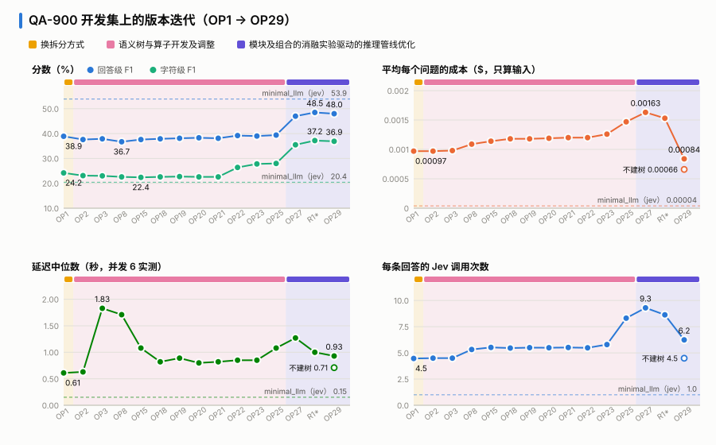
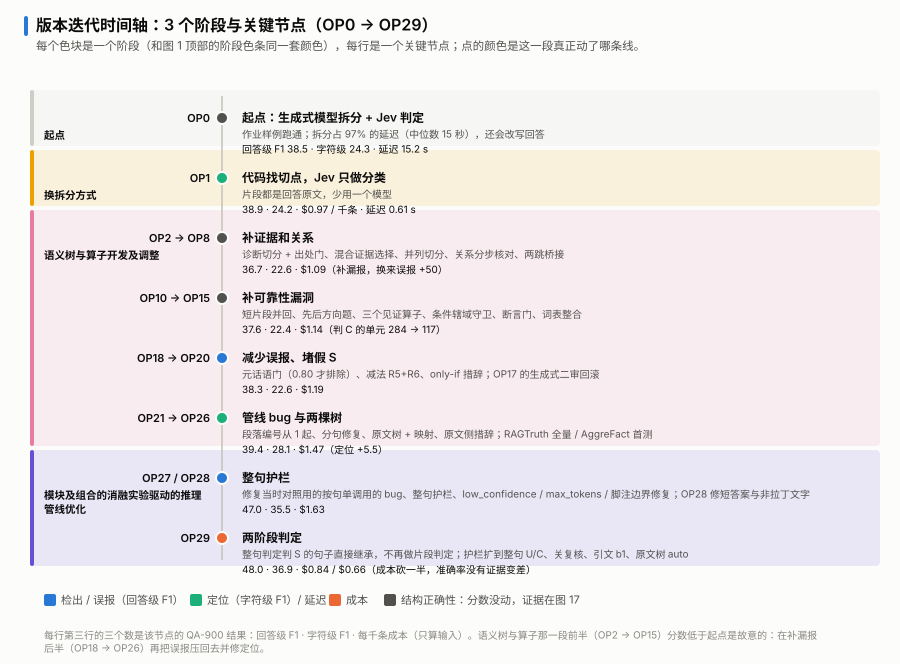

# 版本迭代：OP0 → OP29

[返回 README](../README.zh-CN.md)

优化方法（optimized，又叫 OST）一共迭代了 30 个编号版本，记作 OP0 到 OP29。每个机制是什么，见[设计与实现](design.zh-CN.md)。OP29（提交 `c78c508`）是现行默认。这份文档按三个阶段讲：每个阶段为什么改、改了什么、数字动了多少。

几点口径：
- **QA-900** 是 RAGTruth 里的 900 条 QA 回答，属于开发集，迭代时的回归测试主要看它。RAGTruth 全量 2,700 条也是开发集，所以这里的数字偏乐观。
- 分数用同一个打分脚本。回答级 F1 看「这段回答有没有错」，字符级 F1 看「错的片段标得准不准」。
- 成本按 Jev 标价只算输入（每百万 token $0.042，输出不收费），是调用台账乘标价，不是账单。
- 对照组是 minimal_llm（jev）：每条回答向 Jev 发一次请求，整段回答算一条 claim。

## 一眼看完

| 阶段 | 关键节点 | 代表改动 | QA-900 回答级 F1 | 字符级 F1 | 每千条成本 |
|---|---|---|---:|---:|---:|
| 起点 | OP0 | 生成式模型拆分 + Jev 判定；拆分占 97% 的延迟（15 秒） | 38.5 | 24.3 | $1.82（含拆分模型） |
| 换拆分方式 | OP1 | 代码找切点，Jev 只做分类；延迟 15.2 s → 0.61 s | 38.9 | 24.2 | $0.97 |
| 语义树与算子开发及调整 | OP2 → OP8 | 诊断切分 + 出处门、混合证据选择、并列切分、关系分步核对、两跳桥接 | 36.7 | 22.6 | $1.09 |
| | OP10 → OP15 | 短片段并回、先后方向题、三个见证算子、条件辖域守卫、断言门、词表整合 | 37.6 | 22.4 | $1.14 |
| | OP18 → OP20 | 元话语门、规则精简、only-if 措辞 | 38.3 | 22.6 | $1.19 |
| | OP21 → OP26 | 可追溯性、段落编号从 1 起、分句修复、原文树 + 映射、原文侧措辞 | 39.4 | 28.1 | $1.47 / $1.70 |
| 模块及组合的消融实验驱动的推理管线优化 | OP27 / OP28 | 整句护栏；修 low_confidence、max_tokens、脚注边界；OP28 修短答案和非拉丁文字 | 47.0 | 35.5 | $1.63 |
| | OP29 | 先按句判定（判 S 的句子直接继承）；护栏扩到整句 U/C、关父节点复核、引文选择题、原文树只在长原文上建 | 48.0 | 36.9 | $0.66（原文树常开时 $0.84） |
| 对照 | minimal_llm（jev） | 每条回答一次请求，整段一条 claim | 53.9 | 20.4 | $0.04 |

- 成绩取每个关键节点最后一个有 QA-900 结果的版本。OP28 在 RAGTruth 上和 OP27 判定相同，图里不单列。
- **定位**（字符级 F1 24 → 37）来自第二阶段后半段的分句修复（OP22/23）和第三阶段的整句护栏。
- **检出**（回答级 F1 39 → 48）几乎全来自 OP27 的整句护栏，也就是撤回 OST 自己的误报。
- **成本**在 OP29 降了一半多，比 OP1 还低。
- 和 minimal_llm（jev）比：字符级从 OP1 起就更高（24.2 对 20.4），到 OP29 是 36.9 对 20.4。回答级在 QA-900 上一直没追上（48.0 对 53.9）。整段一次请求判断「有没有错」更准，OST 的价值在说出「错在哪」，详见[消融实验](ablation.zh-CN.md)。
- 第二阶段分数先降后升。前半段（OP2 → OP15）在补漏报，换来了误报；后半段（OP18 → OP26）再把误报压回去，并修定位。这一段最长（约 20 个版本），回答级 F1 却只动了 +0.5，它的价值主要体现在结构正确性上，而不是这张图。

## 时间轴

三个阶段画成三个色块，块里每行是一个关键节点。点的颜色标出这一段动了哪条线：蓝是检出 / 误报，青是定位 / 延迟，橙是成本，灰是结构正确性（分数没动）。

## 各阶段

### 起点 → 换拆分方式（OP0 → OP1）

在方法 2 基础 llm 的基础之上，加上[设计与实现](design.zh-CN.md)里讲的可操作语义树算法，实现了最初的优化版的第一个版本（OP0）。这个版本中为了让回答拆到最小语义，用生成式模型（qwen3.8-flash）拆分回答，Jev 检查拆分是否忠实，再做判定，引用由响应约束校验。

- OP0 的问题：
  - 拆分占了 97% 的延迟（中位数 15 秒）；
  - 生成式模型会顺手改写回答：代词绑错主语，产生碎片和重复。
- OP1 改成「代码在连接词处找切点，Jev 只回答切点属于哪一类」：两件事、因果、转折、先后、整句保留、不是边界。切出来的片段都是回答原文。
- 结果：延迟 15.2 s → 0.61 s，少用一个模型。遗留问题是名词并列（「V1 and protocol V2」）拆不开。

### 语义树与算子开发及调整（OP2 → OP26）

**补证据和关系（OP2 → OP8）**
- 要解决的问题：
  - 保留整句的单元里，半句有依据会把编造的一小块带过去。OP2 加了诊断切分和出处门。
  - 引用缺腿，连接前提的句子过不了相关性门槛。OP3 加了混合证据选择，嵌入只用来选证据，不做判定。
  - 共享开头的并列拆不开（OP5）；带着整句上下文判片段，会被另一半拖累（OP6）。
  - 「A 因为 B」一道题判不准，OP7 改成关系分步核对；两跳推理一道题给不出确定答案，OP8 加了桥接。
- 结果：小测试集第一次整题全对，但 QA-900 回答级 F1 −2.2（38.9 → 36.7），误报多了约 50 个。出处门把人工不算幻觉的转述细节也降了，关系核对把「原文只是并列写了 A 和 B」判成 U。

**补可靠性漏洞（OP10 → OP15）**
- 逻辑探针和两轮外部审计测出的洞：太短的片段被直接丢掉；先后关系写反也能判 S；桥接的属性说的是第三个实体；if 句里的内容被当成无条件事实；见证把符号删了（+5 和 −5 一样）；跨句号拼出原文没有的内容。
- 改法都是单向的：要么往 U 压（短片段并回、方向题、辖域守卫、断言门、符号保留），要么只在有可引前提时升级（三个见证算子）。判 C 的单元从 284 降到 117，判 S 的抽样仍 97% 正确。
- OP15 把几份手工维护的连接词表合成一张，删掉没用的切分投票，行为快照一致。QA-900 回到 37.6。

**减少误报、堵假 S（OP18 → OP20）**
- 元话语门（OP18）：「Based on the passages…」这类不是事实的句子，先问一道「要不要核对」，把握到 0.80 才排除。第一版措辞把带框架的事实句也排除了，吃掉约 11 个真幻觉，收窄后才上线。F1 +0.3，误报 −6。
- 同一轮试过「拿不准的 U 交给生成式模型二审」（OP17），放过了 6 个真幻觉，回滚。
- OP19 是能证明不改结果的简化：三种救援共用一个升级入口。OP20 堵住「L only if F」加「F」推出 L 的假 S，只改了三处措辞。

**管线 bug 与两棵树（OP21 → OP26）**
- OP22 发现判定器看到的段落从 0 编号，而回答写的是「第 3 段」。507 篇被误报的干净回答里，144 篇是这个原因。修完 F1 +0.8，字符级 22.6 → 26.4，代价是 8 个真幻觉从此放过。
- OP23 修分句（括号、空行、行首列表符号），字符级升到 27.8。以冒号结尾的引导句单独成句后，有 111 个被判 U，权衡后接受。
- OP25 引入两棵树：原文也拆成树，回答节点能对上原文片段就判 S 并引用该片段，对不上的交给整篇原文判定。成本 +15%，延迟 0.85 → 1.33 s。OP26 只改原文侧的题目措辞。
- 这一段开始跑全量和外部基准：RAGTruth 全量 62.9，LLM-AggreFact 平均 78.2，都在 OP23–26 之间测的。

### 模块及组合的消融实验驱动的推理管线优化（OP27 → OP29）

这一段是「提出假设 → 预登记判据 → 实验 → 按判据决定」反复循环，最后收到 OP29。

**整句护栏（OP27 = `418ba46`，OP28 = `ade1fdf`）**
- 规则：整句单调用判 S 的句子，撤回 OST 在它上面的片段报警。预登记的四条判据全部通过；窄版和「只放行弱报警」两种变体没过判据，不采用。
- 同一版本里还修了 low_confidence 标记误匹配、长原文超 max_tokens、分句「句号 + 脚注编号」边界。
- QA-900 回答级 F1 39.4 → 47.0，字符级 28.1 → 35.5。
- OP28 修了短答案被误排除，「是不是陈述」也支持非拉丁文字。RAGTruth 上判定和 OP27 相同。

**先按句判定（OP29 = `c78c508`）**
- 机制归因（见[消融实验](ablation.zh-CN.md)）的结论：OST 的检出增益主要来自元话语门和找证据的方式，两者都能搬到单次调用上；原文树映射对检出没有可测的贡献；答案拆分对检出没有贡献，对定位 +1.53。还能提升的方向是「多撤回」：护栏扩到整句 U/C，加上关父节点复核，+0.88。
- OP29 的改动：
  - 整句判 S 的句子直接继承 S，不再做片段判定，只有非 S 的句子才走完整的树判定；
  - 护栏扩展、关父节点复核、引文选择题；
  - 原文树改成按长度自动，原文超过约 2.6 万 token 才建；
  - 修了缓存在并发下的问题。
- RAGTruth 全量（默认配置，不建原文树）：69.63 / 31.84，对 OP27 +0.71 [+0.25, +1.17] / +0.76 [+0.46, +1.04]。成本 $2.57，是 OP27 的 37%。原文树常开时是 69.77 / 31.94，成本是 OP27 的 48%。

## 延迟

关缓存实测，同一批 30 条 QA 回答，并发 6：

| 版本 | 中位数 | p90 | 每条回答的 Jev 调用 |
|---|---:|---:|---:|
| minimal_llm（jev） | 0.15 s | — | 1.0 |
| OP25 | 1.08 s | 1.61 s | 11.9 |
| OP27 | 1.27 s | 1.80 s | 12.8 |
| R1*（OP29 的中间臂：护栏扩展 + 关复核） | 1.00 s（折算约 1.09 s） | 1.49 s | 11.9 |
| OP29，原文树常开 | 0.93 s | 1.47 s | 9.5 |
| OP29，默认（不建原文树） | 0.71 s | 1.35 s | 4.4 |

- 逐条配对：OP29 默认比 OP27 快 0.55 s [0.44, 0.70]，30 条里 29 条更快；不建原文树比建树快 0.17 s [0.08, 0.24]。
- 把延迟降下来的主要是先按句判定（0.93 s）和不建原文树（0.71 s）。R1* 的延迟和 OP25 基本持平。
- minimal_llm（jev）和 R1* 是另一时段补测的。minimal_llm（jev）的 0.15 s 已按同时重测的单次调用折算到同一网络条件；R1* 表里是原始值，那一时段网络快约 8%，折算后约 1.09 s。

## 版本编号对照

OP0 是起点 v1（生成式模型拆分）。OP1 到 OP26 是开发记录里的 jev 到 jev26。OP27 = `418ba46`，OP28 = `ade1fdf`，OP29 = `c78c508`。表里只列关键节点。OP4–7 只在小测试集上跑过，OP16、OP17 是重复或没有上线的版本。
